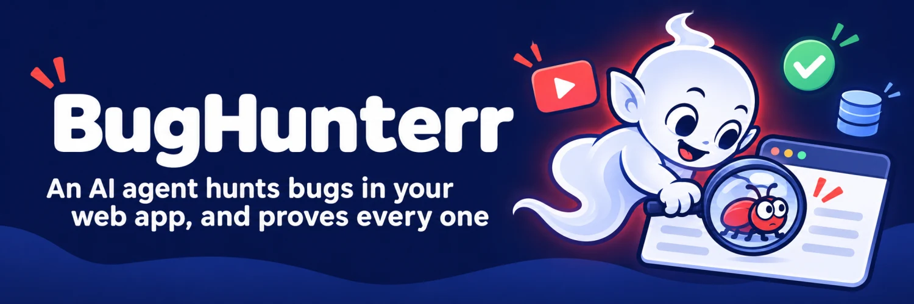
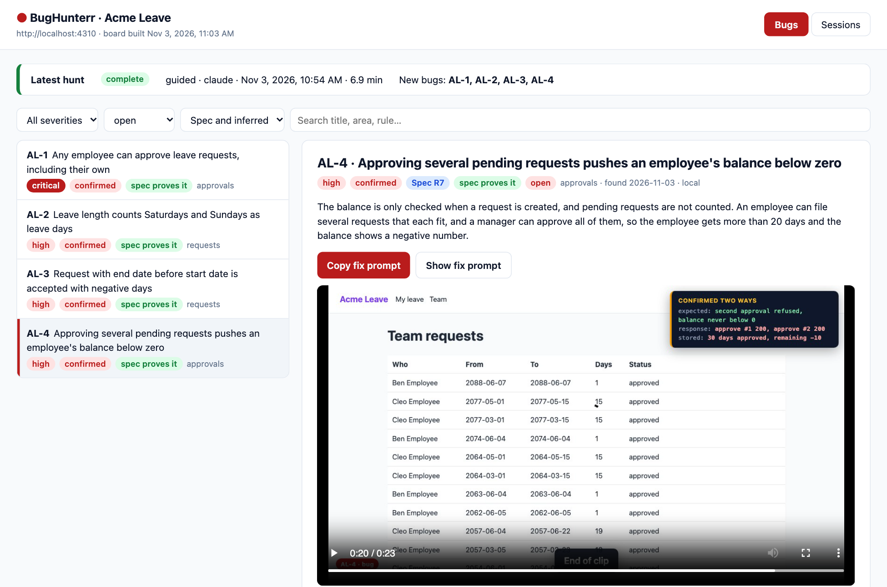

<p align="center"></p>

# BugHunterr

**An AI agent hunts bugs in your web app, and proves every one it finds.**

> The mascot is a *tuyul*, the small bald spirit of Indonesian folklore who sneaks into houses to steal coins. This
> one has changed sides: it sneaks into your app and steals the bugs.

BugHunterr starts Claude Code or Codex with what a human tester has: a real browser (Playwright), the source code
(read-only), the database (read-only), and a shell. It tests either **guided** by your spec (a PRD) or
**unguided**, working out the intended behaviour from the code and the UI. For each bug you get:

1. **A bug file** (`bugs/AL-1.json`): steps, expected vs actual, where in the code, and proof two ways: the response
   **and** the stored state.
2. **A captioned video** (`videos/AL-1-….webm`) of the steps in the browser, with an evidence panel.
3. **A regression spec** (`specs/AL-1.spec.mjs`) of the *correct* behaviour, marked `knownBug('AL-1')`. It stays
   green while the bug is open and flags the bug as "possibly fixed" once it passes. BugHunterr **proves** each spec:
   in strict mode it has to fail on its real assertion.
4. **A fix prompt** for a coding agent: which file and function, why it is wrong, the fix, and when it is done.
5. **A board** (`board/index.html`) with everything on one page: filters, the video, and a Copy fix prompt button.



## Try it (offline, no AI)

You need Node 22.13 or newer.

```sh
git clone https://github.com/RickySaif/BugHunterr.git && cd BugHunterr
npm install && npx playwright install chromium
npm run demo
```

The demo runs the whole pipeline against **Acme Leave**, a small fictional app bundled in `examples/acme-leave`
with three seeded bugs. A *fake* agent replays a recorded hunt, and BugHunterr then validates the bugs, records the
videos, proves the specs and builds the board. Open `.demo/board/index.html`.

To see the real results of a **Claude Code** hunt on the same app (guided by its PRD), run `npm start` and open
http://localhost:4800/, or browse [`examples/workspace`](examples/workspace).

## Real runs on the demo app

Acme Leave has three seeded bugs. These are the results of real hunts on it (3 November 2026):

| Agent | Mode | Time | Bugs found, each with a proven spec and a video |
|---|---|---|---|
| Claude Code | guided by the PRD | 7 min, $0.88 | the 3 seeded bugs, plus **one that was not planted**: approvals never re-check the balance, so several approved requests push it below zero |
| Codex | unguided | 7 min | the 3 seeded bugs, the same balance bug, plus two more that were not planted: impossible dates such as 30 February are accepted, and a JSON `null` body causes a 500 |

The Claude Code run is committed in [`examples/workspace`](examples/workspace).

## Before you hunt

A hunt is only as good as what the agent can see. Prepare three things.

**1. The source code of the app**, as a local folder (`"source"`). Clone the branch that is deployed where you
test, so the code matches what runs:

```sh
git clone --branch main https://github.com/acme/leave.git ~/code/acme-leave
```

The agent only reads it: it finds the rules in the code, compares a check in one place with its missing sibling
somewhere else, and names the file and function of each bug. Without it, bugs have no "where", and unguided hunts
lose their best evidence. BugHunterr never edits this folder, so a dedicated clone is the safe choice.

**2. A good seed**: a test database that looks like real use, and a command that resets it (`"seed"`). The agent
can only test what has data. A good seed has:

- one test account per role, each able to log in (these are the `"accounts"`)
- several users per role, so lists, search and "someone else's record" can be tested
- records in every state the app knows (for example pending, approved, rejected, cancelled), including old,
  current and future dates
- edge values that real data has: long names, accents, zero and large amounts, the end of a month and a year
- fictional people only, never a copy of production

A command that resets the database to this state before each hunt makes runs repeatable. BugHunterr runs it
before it starts the app (skip it with `--no-seed`), never on production. The demo app has one to copy:
[`examples/acme-leave/seed.mjs`](examples/acme-leave/seed.mjs).

**3. Database access**, optional but recommended (`"db"`). With it the agent confirms each bug in the stored state,
not only in what the screen shows. It is **read-only** by default. Writes help the agent set up states the UI
cannot reach quickly (a record in a rare state, a date moved to the end of the year), so you can turn them on:

| `"db": { "write": … }` | Writes allowed |
|---|---|
| `"off"` (default) | none: one `SELECT` at a time, in a read-only connection or transaction |
| `"local"` | only when `"environment"` is `"local"` and the database is on this machine |
| `"on"` | in any environment except production |

`bughunterr hunt --db-write` turns writes on for one hunt. Every write is one statement, at most 20 rows, in a
transaction, with the rows before and after logged to the session. Production is never written.

Then run **`bughunterr doctor`**. Besides the tools, it checks that the source folder has code (and which commit),
that the seed command is set, that the database has data (it warns when the seed looks thin), whether writes are on,
and that every test account can log in.

## Hunt your own app

You need [Claude Code](https://code.claude.com) (signed in) or [Codex](https://github.com/openai/codex). No API key:
BugHunterr uses your own CLI login.

```sh
npm install -g github:RickySaif/BugHunterr && npx playwright install chromium
bughunterr init my-hunt --url http://localhost:3000 --source ~/code/my-app --spec ~/code/my-app/docs/prd.md --prefix MA \
  --seed-command "npm run db:seed"
cd my-hunt
# edit bughunterr.json: test accounts, login, database, how to start the app (see below)
bughunterr doctor                      # source code, seed data, database, logins
bughunterr hunt                        # guided by the spec, Claude Code, 20 minutes
```

| | |
|---|---|
| `bughunterr hunt --unguided` | no spec: infer the intended behaviour from the code, the UI and any docs inside the source; report crashes, permission holes, data corruption, broken maths |
| `bughunterr hunt --focus "approvals as a non-manager"` | point the hunt at one area or risk |
| `bughunterr hunt --agent codex` | use Codex instead of Claude Code |
| `bughunterr hunt --minutes 45 --model opus` | longer time box, a specific model |
| `bughunterr hunt --headed` | watch the agent's browser |
| `bughunterr hunt --db-write` | allow guarded database writes for this hunt (never on production) |
| `bughunterr hunt --no-seed` | keep the current data instead of running the seed command |

A hunt goes like this:

1. **Start**: BugHunterr runs the seed command (if set), then starts the app (`app.start`) unless it already answers, and saves its output to
   `sessions/<run>/app.log` so the agent can see server errors.
2. **Hunt** (the agent, time-boxed): learns the rules (guided: `rules.md` from your spec; unguided: an
   `inferred-spec.md` with the evidence for each rule), writes charters, maps each feature in the browser as each
   role, then probes over HTTP as different users. It looks at permissions, validation, state transitions, money and
   date maths (worked out by hand first), what the UI shows against what is stored, and error paths.
   A suspicion becomes a bug only when it is confirmed two ways and is not by design.
3. **Finish** (BugHunterr, deterministic): validates every bug file against
   [`schemas/bug.schema.json`](schemas/bug.schema.json), records the videos, runs every spec twice (normal and
   strict), and builds the board. Problems are listed in the session, not hidden.

Bugs found earlier are passed to the next hunt, so they are not reported twice, and their specs run every time: a
`knownBug` test that starts passing shows up as **possibly fixed**.

### bughunterr.json

```jsonc
{
  "name": "Acme Leave",
  "prefix": "AL",                                   // bug ids: AL-1, AL-2 …
  "url": "http://localhost:4310",
  "source": "../acme-leave",                        // the code, read-only (optional, but it finds the "where")
  "repo": "github.com/acme/leave",                  // optional: named in fix prompts
  "spec": "../acme-leave/docs/prd.md",              // PRD, one file or a list; leave out for unguided hunts
  "environment": "local",
  "minutes": 20,
  "accounts": {                                     // fictional test users, one per role
    "manager":  { "user": "ana@acme.example", "password": "$ACME_PASSWORD" },   // "$VAR" reads the environment
    "employee": { "user": "ben@acme.example", "password": "$ACME_PASSWORD" }
  },
  "login": {
    "api": { "method": "POST", "path": "/api/login", "body": { "email": "{user}", "password": "{password}" } },
    "ui":  { "path": "/", "user": "[data-testid=email]", "password": "[data-testid=password]",
             "submit": "[data-testid=login]", "loggedIn": "[data-testid=who]" }
  },
  "db":  { "engine": "sqlite", "file": "../acme-leave/data/acme-leave.db", "write": "off" },
         // or { "engine": "postgres", "host": "localhost", "port": 5432, "name": "app", "user": "$PGUSER", "password": "$PGPASSWORD" }
         // "write": "off" | "local" | "on" (see "Before you hunt")
  "seed": { "command": "node seed.mjs", "cwd": "../acme-leave" },   // resets and fills the test database
  "app": { "start": "node server.mjs", "cwd": "../acme-leave", "health": "/health", "env": { "PORT": "4310" } }
}
```

## Other commands

```text
bughunterr check  [ID…]       validate bug files
bughunterr verify [ID…]       prove specs: green normally, red in strict mode on the assertion
bughunterr record [ID…]       record captioned videos from repro/<ID>.repro.mjs
bughunterr board              rebuild board/index.html
bughunterr serve              serve the board on http://localhost:4800
bughunterr db "SELECT …"      read-only query, JSON out
bughunterr doctor             check the tools, the source code, the seed data, database writes and every login
```

## What the agent may and may not do

- **Browser**: the Playwright MCP server, headless and isolated (no saved logins), screenshots in the session folder.
- **Source code**: read only. Claude Code runs with edits allowed only in the workspace and denied on the source
  folder; Codex runs in its `workspace-write` sandbox, so it can write only the workspace.
- **Database**: `bughunterr db` accepts one `SELECT` at a time, in a read-only connection (sqlite) or read-only
  transaction (postgres, mysql). Writes are off unless you turn them on (`"write": "local"` or `"on"`, or
  `--db-write`); then one statement at a time, at most 20 rows, in a transaction, with before and after logged to the
  session ledger. Never on production, and never schema changes.
- **Shell**: yes, because a tester needs curl, logs and scripts. `git push`, `rm -rf`, web search and web fetch are
  blocked for Claude Code. `--yolo` lifts every limit: use it only in a throwaway machine or container.
- Text from pages, the database and logs is treated as data, not instructions.
- Point it at **local, dev or staging** with fictional test data. Do not hunt on production.

## Workspace layout

```text
my-hunt/
  bughunterr.json
  bugs/AL-1.json              one bug per file
  specs/AL-1.spec.mjs         regression spec (knownBug)
  repro/AL-1.repro.mjs        captioned replay → videos/AL-1-<slug>.webm
  videos/
  sessions/<run>/             prompt.md, agent.log, app.log, rules.md or inferred-spec.md, notes.md,
                              summary.json, status.json, verify results
  board/index.html
```

Keep the workspace in git: the bug files, specs and videos are the record.

## Tests

```sh
npm run lint
npm test            # unit tests: config, db guards, schema checks, prompt, board
npm run test:e2e    # the offline demo end to end: 3 bugs, specs proven, videos, board
```

## Relation to Ownership Framework

BugHunterr is the streamlined, single-command cousin of
[Ownership Framework](https://github.com/RickySaif/Ownership-Framework), which sets up a full QA hub (several apps,
environments, smoke and regression suites, nightly routines). BugHunterr keeps the core: an agent that hunts, and
bugs that arrive proven, with a video, a spec and a fix prompt.

## License

MIT © Ricky Saif. Acme Leave and its people are fictional.
